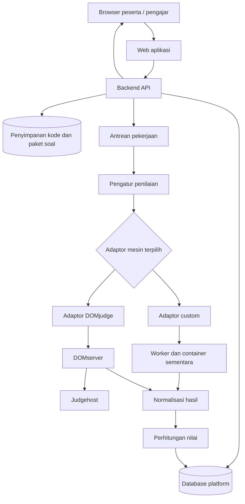

# Rancangan Platform Pembelajaran C/C++ dengan Penilaian Modular

Status: rancangan acuan; fondasi, akun/authoring, learning path, progres, serta UI web peserta/pengajar sudah diimplementasikan untuk penggunaan lokal. Lihat [README.md](README.md) dan [PANDUAN_WEB.md](PANDUAN_WEB.md) untuk status fitur dan cara menjalankan.  
Tanggal: 30 Oktober 2026.

## 1. Tujuan dan ruang lingkup

Platform menyediakan pembelajaran interaktif berbahasa Indonesia untuk **C dan C++**. Peserta membaca materi, menulis program di browser, mencoba program dengan input sendiri, dan mengirim jawaban untuk dinilai otomatis.

Target produk adalah **web dinamis**: materi, soal, kunci penilaian, dan learning path dikelola melalui aplikasi oleh pengajar yang berwenang, disimpan di MariaDB, dan ditampilkan sesuai publikasi serta hak akses. Penambahan konten tidak memerlukan perubahan kode aplikasi, seed manual, atau pembangunan ulang image Docker. Soal `sum-v1` pada implementasi saat ini merupakan data contoh untuk memvalidasi fondasi.

Mesin penilai dibuat modular. Administrator atau pengajar dapat memilih **judge custom** atau **DOMjudge** tanpa mengubah antarmuka belajar peserta. Pemilihan dapat berbeda antar kelas dan soal.

Fitur awal:

- Akun peserta, pengajar, dan administrator.
- Kelas, modul, materi, dan soal bertahap.
- Editor kode dengan pilihan C/C++ sesuai bahasa yang diizinkan soal.
- Tombol **Jalankan** untuk mencoba input sendiri.
- Tombol **Kirim Jawaban** untuk penilaian resmi.
- Riwayat kiriman, hasil penilaian, nilai, dan progres belajar.
- Panel pengajar untuk soal, kasus uji, batas sumber daya, dan aturan nilai.
- Pengelolaan materi dan soal melalui draft, preview, validasi, publikasi, revisi, dan arsip.
- Learning path C/C++ dengan urutan materi, prasyarat, latihan wajib/opsional, serta progres per peserta.
- Pengelolaan solusi acuan dan kunci penilaian secara privat, terpisah dari data yang dikirim ke peserta.
- Pemilihan mesin penilai serta pemantauan kesiapan layanan.

Versi awal berfokus pada program konsol satu berkas yang menggunakan standard input dan standard output. Soal interaktif, proyek banyak berkas, paket eksternal, analisis kemiripan kode, dan penilaian otomatis kualitas kode berada di luar cakupan awal.

### 1.1 Peran dan ruang lingkup akses

| Peran | Kemampuan utama | Batas akses |
|---|---|---|
| Pengunjung | Melihat katalog serta preview yang dinyatakan publik | Tidak mengakses konten privat, kunci, atau riwayat peserta |
| Peserta | Mengikuti kelas/path, membaca materi terbit, mengerjakan latihan, melihat progres sendiri | Terikat keanggotaan, versi path, dan prasyarat |
| Pengajar | Mengelola materi, soal, kunci, path, publikasi, dan hasil peserta | Hanya kelas/konten yang dimiliki atau ditugaskan kepadanya |
| Administrator | Mengelola akun/peran, konfigurasi provider, kuota, dan operasi platform | Akses administratif sensitif dicatat; tidak dipakai sebagai akun belajar sehari-hari |

Kepemilikan konten dan keanggotaan kelas diperiksa di backend pada setiap operasi. Label peran pengajar tidak otomatis memberikan akses ke semua kelas atau kunci milik pengajar lain.

### 1.2 Alur kerja pengajar dan publikasi konten

1. Pengajar membuat kelas atau memilih kelas yang menjadi tanggung jawabnya.
2. Pengajar menyusun modul, tujuan pembelajaran, materi, contoh kode, dan langkah belajar.
3. Pengajar membuat soal beserta bahasa yang diizinkan, kode awal, spesifikasi input/output, kasus uji, dan solusi acuan.
4. Pengajar mencoba soal melalui preview dan validasi paket; kode acuan tetap dieksekusi dalam sandbox.
5. Pengajar menempatkan materi/soal ke learning path, mengatur urutan, prasyarat, serta syarat kelulusan.
6. Setelah validasi otomatis lulus, pengajar yang berwenang menerbitkan versi konten/path. Review oleh rekan dapat ditambahkan sebagai kebijakan kelas, bukan syarat bawaan.
7. Peserta yang memiliki akses dapat mengikuti versi terbit. Hasil latihan dihitung dari penilaian resmi server.

Status penyuntingan dasar: `draft -> validating -> published -> archived`. Kegagalan validasi mengembalikan draft dengan penjelasan. Preview draft hanya tersedia untuk pengelola yang berwenang. Sebelum publikasi, data uji, profil bahasa, checker, aturan nilai, dan kesiapan provider harus valid.

Konten yang telah terbit tidak diedit di tempat. Revisi menghasilkan draft versi baru; publikasi menunjuk versi baru secara atomik setelah seluruh rujukan siap. Simpan nomor revisi untuk mendeteksi penyuntingan bersamaan dan mencegah perubahan pengajar saling menimpa. Arsip menyembunyikan konten dari pendaftaran baru, tetapi mempertahankan rujukan riwayat. Hard delete versi individual yang sudah dipakai peserta tidak tersedia. Pengecualian eksplisit adalah penghapusan seluruh kelas oleh pemilik/admin dengan konfirmasi nama kelas: seluruh konten dan riwayat akademik kelas tersebut dihapus dalam satu transaksi.

### 1.3 Learning path dan pengalaman belajar

Struktur yang diusulkan:

```text
Kelas
  Learning path versi terbit
    Modul
      Materi
        Langkah penjelasan / contoh kode / latihan
```

Learning path adalah jalur belajar yang dapat digunakan oleh kelas. Materi dapat dirujuk oleh beberapa path melalui versi yang eksplisit. Pada tampilan materi, peserta melihat langkah yang harus diselesaikan serta posisi materi tersebut di keseluruhan path.

Contoh urutan **Dasar C**: pengenalan -> input/output -> variabel -> percabangan -> perulangan -> fungsi -> array -> pointer. Path **Dasar C++** dapat memakai urutan dan latihan tersendiri. Soal yang mendukung kedua bahasa dapat digunakan kembali sesuai profil yang diizinkan.

| Elemen | Pengaturan pengajar |
|---|---|
| Identitas path | Judul, deskripsi, sasaran, level, dan bahasa |
| Susunan | Modul, materi, langkah, serta urutan tampilan |
| Prasyarat | Materi/latihan yang harus selesai sebelum langkah berikutnya terbuka |
| Jenis langkah | Wajib atau opsional |
| Syarat selesai | Konfirmasi membaca atau kelulusan latihan resmi |
| Akses | Publik/preview yang diizinkan atau peserta kelas tertentu |

Aturan progres:

- Versi awal mendukung jalur berurutan dan prasyarat tambahan dengan logika **semua prasyarat harus selesai**. Cabang adaptif otomatis dan rekomendasi berbasis AI berada di luar cakupan awal.
- Hubungan prasyarat tidak boleh membentuk siklus, menunjuk versi yang tidak tersedia, atau membuat langkah wajib mustahil diselesaikan.
- Backend memeriksa prasyarat saat membuka langkah dan mengirim jawaban, termasuk akses lewat URL/API langsung. Kunci pada tampilan saja tidak cukup.
- Konfirmasi membaca hanya mencatat aktivitas, bukan bukti pemahaman. Latihan wajib memakai kelulusan dari attempt resmi; tombol Jalankan, draft, dan hasil `system_error` tidak menambah progres.
- Untuk nilai biner, latihan selesai ketika mendapat `ACCEPTED`. Ambang nilai lain baru diaktifkan jika kebijakan nilai dan provider mendukungnya.
- Progres path = jumlah langkah wajib yang selesai / jumlah langkah wajib x 100. Langkah opsional tidak menjadi penghalang kelulusan. Path tanpa langkah wajib dinyatakan hanya sebagai referensi dan tidak diberi status kelulusan otomatis.
- Enrollment mencatat versi path yang diikuti. Revisi path/materi/soal tidak otomatis menghapus penyelesaian lama. Pemindahan peserta ke versi baru dan pemetaan progres dilakukan melalui kebijakan migrasi yang eksplisit serta tercatat.
- Penyelesaian dan nilai selalu dikaitkan dengan peserta, enrollment, versi langkah, serta attempt resmi. Peristiwa hasil yang diterima ulang tidak menggandakan progres.
- Jika penilaian ulang mengubah nilai resmi, dampaknya pada progres harus mengikuti kebijakan kelas yang tercatat. Pembatalan kelulusan karena koreksi tidak dilakukan diam-diam.

### 1.4 Halaman web yang ditargetkan

| Area | Halaman utama |
|---|---|
| Publik | Katalog C/C++, detail learning path, dan preview yang diizinkan |
| Peserta | Dashboard, path dan progres, materi bertahap, editor/Jalankan/Kirim, serta riwayat sendiri |
| Pengajar | Dashboard kelas, editor materi, bank soal dan kunci, penyusun path, preview/publikasi, serta progres peserta kelas |
| Administrator | Akun/peran, konfigurasi provider, kuota, audit, dan kesehatan layanan |

Web mengambil konten dari API berdasarkan versi terbit dan izin pengguna. Backend menentukan akses, kelulusan, dan provider resmi. Kredensial serta kunci penilaian tidak disematkan dalam HTML, bundle JavaScript, atau payload publik.

## 2. Prinsip arsitektur

1. Platform pembelajaran tidak bergantung langsung pada API atau penyimpanan internal mesin penilai.
2. Setiap mesin diakses melalui adaptor dengan kontrak yang sama.
3. Eksekusi program, pemeriksaan hasil, dan perhitungan nilai memiliki tanggung jawab terpisah.
4. Soal dan kasus uji memiliki versi yang tidak diubah setelah dipakai untuk penilaian.
5. Setiap percobaan penilaian mencatat mesin, versi soal, profil compiler, dan kebijakan nilai yang digunakan.
6. Informasi yang tidak disediakan mesin tidak boleh ditebak atau dianggap bernilai nol.
7. Kegagalan infrastruktur tidak dihitung sebagai kesalahan peserta.
8. Hak akses pengelolaan mesin hanya tersedia di backend; browser peserta tidak menerima kredensial mesin.
9. Konten dikelola secara dinamis dengan versi publikasi dan pemeriksaan kepemilikan di server.
10. Progres belajar dihitung di server dari versi path dan hasil resmi; permintaan browser tidak dipercaya sebagai bukti kelulusan.

## 3. Arsitektur logis



| Komponen | Tanggung jawab |
|---|---|
| Web aplikasi | Materi, editor, hasil, progres, dan panel pengelolaan |
| Backend API | Otorisasi, validasi, penyimpanan submission, dan pembacaan hasil |
| Database platform | Data pembelajaran, konfigurasi, pemetaan provider, dan riwayat penilaian |
| Penyimpanan artefak | Kode sumber, paket soal, dan log dengan akses terbatas |
| Antrean | Menampung pekerjaan dan membatasi beban eksekusi |
| Pengatur penilaian | Memilih adaptor, mengirim pekerjaan, memantau hasil, dan mengatur percobaan ulang |
| Adaptor | Menerjemahkan kontrak platform ke layanan mesin dan menormalisasi hasil |
| Mesin custom | Kompilasi dan eksekusi terisolasi serta pemeriksaan output |
| DOMjudge | Eksekusi dan penilaian melalui DOMserver serta judgehost |
| Perhitungan nilai | Mengubah bukti hasil pengujian menjadi nilai sesuai kebijakan soal |

Modul pengatur dan adaptor boleh berada dalam satu aplikasi worker pada tahap awal. Modularitas tidak mengharuskan setiap modul menjadi microservice.

### 3.1 Teknologi fondasi yang dipilih

| Kebutuhan | Pilihan | Peran |
|---|---|---|
| Backend API | Python dan FastAPI | Validasi permintaan, API submission, serta pembacaan hasil |
| Database platform | MariaDB | Data pembelajaran, submission, attempt, konfigurasi, dan nilai resmi |
| Akses database | SQLAlchemy dengan PyMySQL | Model data dan transaksi ke MariaDB |
| Migrasi skema | Alembic | Perubahan skema database yang dapat dilacak |
| Broker antrean | Redis | Pengiriman pekerjaan ke worker |
| Worker | Celery | Menjalankan pengaturan penilaian di proses terpisah dari API |
| Kompilasi C/C++ | GCC dan G++ | Profil awal C17 dan C++17 |
| Lingkungan layanan | Docker Compose | Menjalankan API, database, Redis, dan worker |

MariaDB dipilih dari opsi MySQL/MariaDB yang disetujui pengguna. Database ini menjadi sumber utama status dan hasil resmi; Redis digunakan sebagai broker, bukan penyimpanan permanen nilai. Penggantian ke MySQL di kemudian hari memerlukan pengujian kompatibilitas skema dan migrasi, meskipun SQLAlchemy mendukung keduanya.

Dokumentasi FastAPI menyarankan alat seperti Celery untuk pekerjaan berat yang perlu diproses terpisah; Celery mendukung Redis sebagai broker. SQLAlchemy menyediakan dukungan MySQL/MariaDB melalui PyMySQL. Lihat referensi teknis di akhir dokumen.

Worker Celery mengatur pekerjaan melalui adaptor; kode peserta tetap dieksekusi di lingkungan terisolasi, bukan langsung di proses worker. Kegagalan antara penyimpanan submission dan pengiriman pesan harus ditangani melalui pencatatan pekerjaan persisten dan mekanisme pengiriman ulang/rekonsiliasi yang idempoten.

UI memakai HTML/CSS dan JavaScript ES modules yang dilayani FastAPI dari folder `web/` pada origin yang sama. Tidak memerlukan Node.js saat runtime. Styling mengikuti [DESIGN.md](DESIGN.md), dengan font terbuka yang disimpan lokal. Playwright dan Microsoft Edge dipakai untuk pengujian browser. Penyimpanan artefak awal memakai database/volume privat; backend penyimpanan tetap terpisah dari kontrak judge agar dapat diganti kemudian.

## 4. Dukungan bahasa C dan C++

Gunakan ID profil bahasa yang eksplisit, bukan hanya label `C` atau `C++`.

| Profil awal | Berkas | Compiler | Contoh opsi |
|---|---|---|---|
| `c17` | `main.c` | GCC | `-std=c17 -O2 -Wall -Wextra` |
| `cpp17` | `main.cpp` | G++ | `-std=c++17 -O2 -Wall -Wextra` |

Profil tambahan seperti C++20 dapat ditambahkan setelah tersedia dan diverifikasi pada mesin yang dipakai. Versi compiler serta image harus dipatok dan dicatat. Peringatan compiler ditampilkan sebagai umpan balik; tidak otomatis menggagalkan kompilasi.

Pengajar menentukan bahasa yang diizinkan per soal. Adaptor DOMjudge memetakan ID profil platform ke ID bahasa di instalasi DOMjudge. Jika profil tidak tersedia atau standar bahasanya tidak sesuai, konfigurasi harus ditolak sebelum submission diterima.

Seluruh perintah kompilasi berasal dari profil tepercaya. Peserta tidak boleh mengirim perintah shell, opsi compiler bebas, atau image container sendiri.

## 5. Kontrak adaptor mesin

Kontrak berikut bersifat konseptual dan tidak terikat bahasa pemrograman backend.

```text
JudgeProvider
  capabilities()                       -> ProviderCapabilities
  healthCheck()                        -> ProviderHealth
  prepareProblem(problemVersion)       -> ProviderProblemReference
  submit(judgeRequest, idempotencyKey)  -> ProviderJobReference
  getResult(providerJobReference)       -> JudgeResult
```

Pembatalan dan permintaan penilaian ulang dapat menjadi kemampuan opsional. Penilaian ulang lintas mesin selalu direpresentasikan sebagai attempt baru pada platform.

### 5.1 Permintaan penilaian

```json
{
  "submission_id": "sub-001",
  "attempt_id": "attempt-001",
  "problem_version_id": "problem-001-v1",
  "language_profile": "cpp17",
  "source_artifact_id": "source-001",
  "limits_profile_id": "limits-basic-v1",
  "scoring_policy_version_id": "binary-v1"
}
```

Permintaan merujuk data yang sudah divalidasi dan disimpan oleh platform. Kredensial provider tidak dimasukkan ke payload antrean.

### 5.2 Hasil penilaian

```json
{
  "submission_id": "sub-001",
  "attempt_id": "attempt-001",
  "provider": "custom",
  "provider_job_id": "job-001",
  "state": "completed",
  "verdict": "WRONG_ANSWER",
  "passed_tests": 4,
  "total_tests": 5,
  "score": 80,
  "time_ms": null,
  "memory_kb": null,
  "compile_log_artifact_id": null,
  "test_results": [],
  "raw_result_artifact_id": "result-001"
}
```

Contoh tersebut memakai kebijakan nilai parsial. `score` ditambahkan oleh modul perhitungan nilai platform setelah hasil mesin dinormalisasi; mesin tidak harus menyediakannya. Rincian kasus dihilangkan pada contoh agar singkat.

Aturan data hasil:

- `null` berarti tidak tersedia atau belum diketahui; berbeda dari nol.
- Rincian kasus, waktu, memori, dan log hanya disajikan jika benar-benar tersedia.
- Definisikan satuan dan cara agregasi metrik secara eksplisit sebelum implementasi; waktu CPU dan waktu nyata tidak boleh disamakan.
- Simpan verdict serta payload asli untuk audit, dengan penyaringan data sensitif dan masa retensi.
- Hasil mentah mesin tidak dikirim langsung ke browser.
- Unknown verdict tidak diterjemahkan menjadi Accepted atau Wrong Answer; tandai sebagai kesalahan integrasi.

### 5.3 Kemampuan provider

Contoh kemampuan yang perlu diperiksa:

```text
language_profiles
supports_custom_input
supports_test_details
supports_partial_scoring
supports_group_scoring
supports_source_analysis
supports_cancellation
```

Kemampuan ditentukan berdasarkan implementasi adaptor, versi mesin, konfigurasi, serta izin API. Kemampuan DOMjudge tidak diasumsikan hanya dari nama produknya. Soal yang membutuhkan kemampuan tertentu tidak boleh diarahkan ke provider yang belum memenuhinya.

## 6. Pemilihan mesin secara dinamis

Urutan prioritas konfigurasi:

```text
Pilihan pada soal -> pilihan pada kelas -> default platform
```

Contoh konfigurasi konseptual:

```yaml
judging:
  default_provider: custom
  fallback_enabled: false

courses:
  dasar-pemrograman:
    provider: custom
  latihan-kompetisi:
    provider: domjudge
```

Backend menyelesaikan pilihan mesin ketika submission diterima, lalu menyimpannya pada attempt. Worker tidak membaca ulang default terbaru untuk mengganti pilihan pekerjaan yang sudah mengantre.

Sebelum konfigurasi diaktifkan, platform memeriksa:

1. Adaptor terdaftar dan layanan siap menerima pekerjaan.
2. Profil C/C++ yang dibutuhkan tersedia.
3. Versi soal telah disiapkan pada mesin tersebut.
4. Checker, batas sumber daya, dan kebijakan nilai didukung.

Pergantian konfigurasi berlaku untuk submission berikutnya. Riwayat tidak berubah. Penilaian ulang memakai attempt baru dan menyimpan relasinya dengan attempt sebelumnya.

Jika provider gagal, pekerjaan masuk status menunggu percobaan ulang atau kesalahan sistem. **Tidak ada fallback otomatis lintas provider pada versi awal**, karena lingkungan compiler, checker, dan pembatasan dapat menghasilkan perilaku berbeda.

## 7. Pengelolaan soal dan kasus uji

Platform menjadi sumber utama soal dan versi penilaian. Satu versi soal mencakup:

- Pernyataan soal dan batas domain input.
- Profil bahasa yang diizinkan.
- Kode awal C/C++ jika diperlukan.
- Kasus uji terbuka dan tersembunyi.
- Jawaban yang diharapkan dan checker.
- Batas kompilasi, eksekusi, memori, output, dan proses.
- Kebijakan nilai serta bobot kelompok jika ada.
- Solusi acuan untuk validasi paket, bukan pembanding teks kode peserta.

### 7.1 Makna kunci soal dan validasinya

Untuk soal pemrograman, kunci penilaian terdiri atas **solusi acuan, pasangan input/output yang diharapkan, checker, serta aturan kelulusan**. Sistem tidak menuntut kode peserta sama dengan kode acuan.

Pengajar memasukkan kunci melalui form khusus yang hanya dapat diakses pengelola soal. Input/output dapat diketik atau, ketika fitur impor tersedia, diunggah melalui format yang tervalidasi. Solusi acuan C/C++ dianggap sebagai kode tidak tepercaya dan mendapat isolasi serta batas sumber daya yang sama prinsipnya dengan submission peserta.

Validasi sebelum terbit meliputi:

- Pernyataan soal dan domain input jelas; minimal satu kasus uji tersedia, dengan contoh terbuka dan cakupan kasus tersembunyi yang disarankan.
- Setiap bahasa yang diizinkan diuji menggunakan solusi acuan yang sesuai; batas sumber daya dikalibrasi untuk profil tersebut.
- Solusi acuan lolos seluruh kasus, termasuk nilai batas, nol, dan kondisi khusus yang relevan.
- Jika output dihasilkan dari solusi acuan, hasilnya ditampilkan hanya ke pengajar untuk diperiksa sebelum dibekukan; keluaran acuan tidak otomatis membuktikan kunci bebas kesalahan.
- Checker dan kebijakan nilai tersedia pada provider yang dipilih; batas yang diminta tidak melampaui kebijakan administrator.
- Tidak ada placeholder jawaban atau kunci tersembunyi dalam pernyataan, contoh publik, metadata peserta, maupun preview peserta.

Pengajar memilih checker bawaan atau checker khusus yang telah disetujui administrator. Pengunggahan skrip checker yang dapat berjalan di proses backend/host tidak diperbolehkan. Validasi solusi dan generasi output berjalan sebagai pekerjaan antrean, dengan kuota tersendiri.

Bagian berikut menjelaskan penyimpanan dan sinkronisasi versi soal yang sudah tervalidasi.

Adaptor custom membaca paket internal. Adaptor DOMjudge mengonversinya menjadi paket soal yang kompatibel dan menyinkronkannya melalui mekanisme yang didukung versi DOMjudge terpilih.

Simpan pemetaan:

```text
(provider_instance, problem_version_id)
    -> external_contest_id, external_problem_id, package_hash,
       sync_status, synced_at
```

Perubahan kasus uji atau checker menghasilkan versi baru. Versi lama tetap dapat ditelusuri untuk menjelaskan hasil terdahulu. Sinkronisasi harus selesai sebelum versi soal menerima submission pada mesin tersebut.

### Contoh soal penjumlahan

Soal: baca dua bilangan bulat dalam rentang -1.000.000 sampai 1.000.000, lalu cetak jumlahnya.

| Kasus | Input | Output | Tujuan |
|---|---|---|---|
| 1 | `2 3` | `5` | Nilai positif |
| 2 | `0 0` | `0` | Nol |
| 3 | `-5 2` | `-3` | Campuran tanda |
| 4 | `-7 -8` | `-15` | Nilai negatif |
| 5 | `1000000 1000000` | `2000000` | Batas domain |

Kasus uji harus sesuai spesifikasi input. Semua solusi yang menghasilkan perilaku benar diterima, meskipun susunan kode berbeda dari solusi acuan.

## 8. Cara pemeriksaan dan pemberian nilai

### 8.1 Tahapan pengujian

1. Validasi ukuran kode, bahasa, hak akses, dan kesiapan soal.
2. Kompilasi kode dalam lingkungan terisolasi dengan batas tersendiri.
3. Jika kompilasi berhasil, jalankan executable pada lingkungan baru untuk setiap kasus uji pada runner custom.
4. Kirim input melalui `stdin`; tangkap `stdout` dan `stderr` secara terpisah dengan batas ukuran.
5. Periksa penghentian program dan pelanggaran batas sebelum membandingkan output.
6. Jalankan checker tepercaya di luar lingkungan program peserta.
7. Normalisasi hasil, hitung nilai, dan simpan bukti penilaian.

Untuk DOMjudge, adaptor menyerahkan eksekusi kepada mekanisme DOMjudge, kemudian memetakan hasil yang tersedia. Jangan mengasumsikan urutan internal atau jumlah kasus yang benar-benar dieksekusi sama dengan runner custom.

### 8.2 Checker

| Jenis | Penggunaan |
|---|---|
| Exact | Teks harus sama; kebijakan newline dinyatakan jelas |
| Token | Membandingkan urutan token, mengabaikan perbedaan whitespace |
| Numerik | Membandingkan angka dengan toleransi absolut/relatif yang ditetapkan |
| Khusus | Memvalidasi jawaban yang memiliki lebih dari satu keluaran benar |

Gunakan checker token untuk banyak latihan dasar, tetapi jangan menghapus seluruh whitespace secara membabi buta karena token berbeda dapat menjadi terlihat sama. Checker khusus ditulis atau ditinjau pengelola tepercaya dan juga diberi batas eksekusi. Paket soal harus menyatakan jenis checker secara eksplisit.

### 8.3 Status

Pisahkan status pekerjaan dari verdict program.

Status pekerjaan platform:

```text
queued -> dispatching -> running -> completed
                       -> retry_pending -> dispatching
                       -> system_error
```

Detail fase `compiling` dan `testing` boleh ditampilkan jika provider menyediakannya. `system_error` berarti proses penilaian tidak berhasil menghasilkan keputusan valid, bukan bahwa program peserta salah.

Verdict yang dinormalisasi:

| Verdict | Makna |
|---|---|
| `ACCEPTED` | Memenuhi seluruh syarat kelulusan pengujian |
| `WRONG_ANSWER` | Output tidak sesuai checker |
| `COMPILATION_ERROR` | Kompilasi program gagal |
| `RUNTIME_ERROR` | Program gagal saat dieksekusi |
| `TIME_LIMIT_EXCEEDED` | Melampaui batas waktu |
| `MEMORY_LIMIT_EXCEEDED` | Pelanggaran memori yang dapat diidentifikasi mesin |
| `OUTPUT_LIMIT_EXCEEDED` | Melampaui batas keluaran |

Tidak semua mesin membedakan seluruh verdict tersebut. Simpan status asli dan petakan menurut bukti yang tersedia. Jika ada beberapa jenis kegagalan antar kasus, kebijakan prioritas verdict harus ditentukan dan diberi versi; simpan rincian kasus jika tersedia.

### 8.4 Kebijakan nilai

**Default lintas mesin untuk versi awal: nilai biner.**

```text
Accepted = 100
Jawaban gagal = 0
Gangguan infrastruktur = belum ada nilai
```

Nilai parsial menjadi pilihan ketika mesin menyediakan bukti pengujian yang lengkap sesuai kebijakan:

```text
Nilai = jumlah kasus lolos / jumlah seluruh kasus x 100
```

Misalnya 4 dari 5 kasus lolos menghasilkan 80. Untuk soal lebih kompleks, gunakan kelompok berbobot dengan aturan lulus kelompok yang eksplisit. Mesin yang menghentikan pengujian lebih awal atau hanya menyediakan verdict agregat tidak otomatis memenuhi syarat perhitungan nilai parsial.

Input/output menilai perilaku pada kasus yang diuji, bukan membuktikan kebenaran untuk seluruh kemungkinan input. Penggunaan rekursi, struktur algoritma, keterbacaan, dan penamaan memerlukan rubrik pengajar atau modul analisis kode tersendiri. Pencarian kata di teks sumber tidak cukup untuk membuktikan penggunaan konsep.

## 9. Jalankan dan Kirim Jawaban

| Aspek | Jalankan | Kirim Jawaban |
|---|---|---|
| Input | Input bebas peserta | Kasus uji versi soal |
| Tujuan | Eksperimen dan debugging | Penilaian resmi |
| Memengaruhi progres | Tidak | Sesuai kebijakan kelulusan |
| Output | Hasil eksekusi dan error yang disaring | Verdict, nilai, dan umpan balik sesuai kebijakan |

Runner untuk **Jalankan** dapat ditetapkan terpisah dari provider penilaian resmi. Jika fitur input bebas tidak tersedia pada provider yang dipilih, gunakan runner yang memang mendukungnya atau nonaktifkan fitur dengan penjelasan. Jangan mensimulasikan dukungan yang tidak ada.

Untuk kasus terbuka, tampilkan input, output yang diharapkan, dan output aktual. Untuk kasus tersembunyi, batasi rincian agar data jawaban tidak bocor. Seluruh keluaran kode dianggap teks tidak tepercaya dan harus di-escape sebelum ditampilkan.

## 10. Docker dan isolasi eksekusi

### 10.1 Kelompok layanan

| Kelompok | Layanan |
|---|---|
| Inti | Web, backend, database platform, antrean, worker pengatur penilaian |
| Custom | Pengendali runner serta container kompilasi/eksekusi sementara |
| DOMjudge | DOMserver, database DOMjudge, dan judgehost |

Usulan menggunakan Docker Compose dengan profil `custom` dan `domjudge`. Instalasi dapat mengaktifkan salah satu atau keduanya. Detail image, cgroup, dan hak akses judgehost mengikuti dokumentasi versi yang dipatok; tidak diasumsikan sama dengan runner custom.

Database MariaDB platform dan database DOMjudge dipisah, termasuk kredensial serta siklus migrasinya. Database DOMjudge mengikuti persyaratan versi DOMjudge yang dipatok. Akses integrasi DOMjudge melalui API, bukan dengan menulis langsung tabel internalnya.

### 10.2 Kebijakan awal runner custom

| Aspek | Usulan awal |
|---|---|
| Kompilasi | Batas terpisah, misalnya 10 detik; memori dikalibrasi untuk GCC/G++ |
| Eksekusi | Misalnya 2 detik per kasus, dengan definisi waktu yang eksplisit |
| Memori eksekusi | Misalnya 128 MB, disesuaikan soal dan kebutuhan C++ |
| Keluaran | Misalnya 1 MB per kasus; stdout dan stderr sama-sama dibatasi |
| Jaringan | Dinonaktifkan pada container kompilasi dan eksekusi |
| Pengguna | Non-root |
| Privilege | Tidak privileged; drop capabilities; no-new-privileges |
| System call | Profil seccomp yang sesuai dan diuji |
| Penyimpanan | Root filesystem read-only; ruang sementara terbatas |
| Proses | Batas jumlah proses dan pembersihan seluruh turunan |
| Artefak | Hanya kode/input atau executable yang dibutuhkan pekerjaan |

Angka di atas adalah titik awal, bukan jaminan kesetaraan antar mesin. Tetapkan batas CPU, memori, swap, file, proses, waktu nyata, dan anggaran total submission secara eksplisit. Pengawas waktu menghentikan seluruh container ketika tenggat terlampaui; kuota CPU Docker sendiri bukan timer eksekusi.

Executable hasil kompilasi harus dipindahkan melalui jalur terkontrol ke proses eksekusi baru. Runner menggunakan satu container fisik per pekerjaan Run/Submit, lalu memulai ulang proses container setelah kompilasi dan setelah setiap input agar ruang PID/tmpfs bersih. Binary disimpan sementara di pengendali dan dikirim ke proses berikutnya; tidak mengandalkan file sisa di sandbox. Container dihapus setelah pekerjaan selesai/gagal. Input dikirim satu per satu. Jawaban acuan, seluruh kumpulan input tersembunyi, kredensial, dan checker tidak dipasang di container peserta.

Container peserta tidak memiliki akses Docker socket atau direktori aplikasi/host. Komponen pengendali yang berwenang membuat container memiliki hak terbatas dan ditempatkan di lingkungan judge tersendiri. Jangan memberikan Docker socket host aplikasi kepada backend web.

Docker berbagi kernel dengan host dan bukan batas keamanan absolut. Untuk layanan publik, pisahkan host judge dari aplikasi/database; pertimbangkan isolasi lebih kuat setelah penilaian ancaman dan kebutuhan operasional.

### 10.3 Kebutuhan keamanan aplikasi dan operasional

Kebutuhan keamanan terperinci, prioritas penerapan, matriks akses, dan pengujian penerimaan ditetapkan pada [KEBUTUHAN_KEAMANAN.md](KEBUTUHAN_KEAMANAN.md). Acuannya adalah OWASP ASVS serta panduan autentikasi, otorisasi, sesi, XSS, dan unggahan berkas.

Autentikasi per pengguna, pemeriksaan kepemilikan kelas/submission, perlindungan kunci, kuota admission server, sanitasi Markdown, dan audit dasar telah ditambahkan pada API tahap 2. Sebelum akses publik, penuhi kontrol tersisa seperti HTTPS, MFA/recovery, hardening runner, pengelolaan rahasia/audit produksi, pembaruan dependensi, serta pengujian pemulihan data. Status terperinci tetap mengacu pada dokumen keamanan; keberadaan persyaratan tidak berarti seluruh variasi kontrolnya sudah diimplementasikan.

## 11. Keandalan dan konsistensi

- Gunakan idempotency key berdasarkan attempt agar pengulangan pesan antrean tidak memicu pengiriman ganda tanpa kendali.
- Tidak diasumsikan semua provider menyediakan API idempotensi. Simpan referensi eksternal secara persisten dan lakukan rekonsiliasi jika permintaan timeout setelah mungkin diterima mesin.
- Pantau provider melalui polling berkala dengan jeda dan batas waktu; integrasi event dapat ditambahkan bila tersedia.
- Perubahan konfigurasi tidak mengalihkan attempt yang sedang berjalan.
- Perbaruan hasil harus idempoten; pesan lama tidak boleh menimpa hasil attempt yang lebih baru.
- Simpan hasil tiap attempt. Tentukan attempt mana yang dipakai untuk nilai resmi melalui kebijakan eksplisit dan catat perubahan tersebut.
- Batasi frekuensi kiriman per peserta serta jumlah pekerjaan paralel per provider.
- Tetapkan tenggat antrean/penilaian dan prosedur retry agar pekerjaan tidak menggantung selamanya.
- Bersihkan container dan berkas meskipun worker berhenti atau mengalami crash.
- Sediakan log terstruktur dengan submission ID, attempt ID, provider, durasi, dan kategori kegagalan; hindari pencatatan rahasia.

Perbandingan hasil antar mesin adalah fitur evaluasi opsional. Jika ditambahkan, hasil eksperimen tidak langsung mengganti nilai resmi. Samakan versi soal, compiler, checker, dan aturan sumber daya sejauh memungkinkan, lalu dokumentasikan perbedaan yang tersisa.

## 12. Model data minimum

| Entitas | Informasi utama |
|---|---|
| `users` | Identitas dan peran |
| `sessions`, `password_reset_tokens` | Sesi yang dapat dicabut dan token pemulihan berumur pendek |
| `courses`, `course_instructors`, `enrollments` | Kelas, penugasan pengajar, keanggotaan, versi path yang diikuti, dan pilihan provider |
| `modules`, `lessons`, `lesson_versions` | Identitas materi, konten versi terbit, draft, dan kepemilikan |
| `lesson_steps` | Penjelasan, contoh kode, dan rujukan latihan berurutan |
| `learning_paths`, `learning_path_versions` | Identitas jalur, versi publikasi, bahasa, dan sasaran |
| `path_items`, `path_prerequisites` | Rujukan versi materi/langkah, urutan, kewajiban, dan prasyarat tanpa siklus |
| `content_collaborators` | Hak penyunting/penerbit pada konten tertentu |
| `problems` | Identitas soal dan pengaturan pemilihan provider |
| `problem_versions` | Spesifikasi penilaian yang dibekukan |
| `reference_solutions`, `problem_validation_jobs` | Solusi acuan privat, profil bahasa, dan hasil validasi sebelum terbit |
| `test_cases`, `test_groups` | Data uji, visibilitas, kelompok, dan bobot |
| `language_profiles` | Bahasa, standar, compiler, dan versi lingkungan |
| `judge_providers` | Instance mesin, status aktif, dan referensi kredensial |
| `provider_problem_mappings` | Hubungan versi soal dengan entitas eksternal |
| `provider_language_mappings` | Hubungan profil bahasa dengan ID bahasa provider |
| `submissions` | Peserta, sumber kode, soal, profil bahasa, dan waktu kirim |
| `judging_attempts` | Snapshot provider/konfigurasi, pekerjaan eksternal, status, verdict, dan nilai |
| `test_results` | Hasil per kasus/kelompok jika tersedia |
| `artifacts` | Referensi kode, log, paket, dan hasil mentah |
| `progress`, `completion_events` | Penyelesaian per enrollment/versi langkah dan bukti attempt resmi yang idempoten |
| `audit_events` | Perubahan peran, kunci, publikasi, konfigurasi, dan nilai resmi |

Kredensial provider disimpan melalui mekanisme rahasia terpisah; tabel konfigurasi hanya menyimpan referensinya. Hak pengajar terhadap kelas dan rincian hasil harus diperiksa pada setiap akses backend.

Pemisahan tabel kunci bukan pengganti otorisasi. Gunakan skema respons peserta yang tidak memiliki field kunci, lalu uji seluruh akses API, pencarian, ekspor, dan unduhan. Tambahkan foreign key, indeks, dan unique constraint untuk keanggotaan, nomor versi, urutan langkah, serta identitas completion event. Saat mendukung penilaian ulang, satu submission dapat memiliki beberapa attempt dan rujukan hasil resmi yang eksplisit; skema awal satu attempt perlu dimigrasikan.

## 13. Tahapan implementasi yang direkomendasikan

### Tahap 1 — Fondasi dan satu alur lengkap

- Docker Compose untuk FastAPI, MariaDB, Redis, dan worker Celery, beserta konfigurasi lingkungan dan health check.
- Model data awal menggunakan SQLAlchemy/PyMySQL serta migrasi Alembic.
- Kontrak provider, format hasil, model submission/attempt, dan antrean.
- Satu soal penjumlahan yang bisa dikerjakan menggunakan C17 dan C++17.
- Adaptor custom dengan kompilasi, eksekusi terisolasi, dan checker token.
- Nilai biner, riwayat, dan pemisahan kesalahan sistem dari kesalahan program.
- API Jalankan/Kirim Jawaban dan dokumentasi Swagger. Fondasi ini sudah berjalan; antarmuka belajar dikerjakan pada tahap 3.

### Tahap 2 — Identitas, keamanan dasar, dan pengelolaan konten dinamis

- Akun peserta/pengajar/administrator, sesi, dan pemeriksaan izin per objek/kelas.
- Pengaitan submission dengan pemilik; pembatasan akses riwayat milik pengguna lain.
- CRUD materi, soal, solusi acuan, dan kasus uji melalui API pengajar dengan skema data publik/privat terpisah.
- Draft, preview, validasi sandbox, revisi, publikasi atomik, dan arsip.
- Kuota per pengguna/kelas untuk submission, run, dan validasi soal.
- Audit perubahan sensitif serta pengujian akses lintas pengguna/kelas.

### Tahap 3 — Learning path dan web peserta/pengajar

- Model path, versi, langkah wajib/opsional, dan prasyarat tanpa siklus.
- Enrollment, progres server, pembukaan langkah, dan kebijakan perubahan versi.
- Halaman katalog, dashboard peserta, materi bertahap, dan editor C/C++.
- Panel pengajar untuk bank konten/kunci, penyusun path, preview, publikasi, dan progres kelas.
- Sanitasi materi serta pengujian akses langsung ke langkah yang terkunci.

### Tahap 4 — Integrasi DOMjudge

- Pilih dan patok versi DOMjudge serta image yang digunakan.
- Siapkan DOMserver, database, dan judgehost.
- Implementasikan pemetaan kontes, pengguna/tim, soal, bahasa, dan submission.
- Validasi hak akses API serta kemampuan hasil pada versi terpilih.
- Sinkronisasi paket dan pemilihan mesin melalui panel pengajar.

### Tahap 5 — Penilaian lanjutan dan kesiapan publik

- Nilai parsial dan kelompok berbobot ketika didukung provider.
- Checker numerik/khusus, umpan balik lebih rinci, dan rubrik pengajar.
- Penilaian ulang, pengamatan operasional, dan perbandingan antar mesin.
- Optimasi kapasitas serta penguatan isolasi untuk penggunaan publik.
- Penyelesaian kontrol keamanan sebelum publik sesuai [KEBUTUHAN_KEAMANAN.md](KEBUTUHAN_KEAMANAN.md), uji pemulihan backup, serta evaluasi beban dan penyalahgunaan.

Kontrol keamanan bukan pekerjaan yang ditunda seluruhnya ke tahap 5: autentikasi, otorisasi, kerahasiaan kunci, dan kuota menjadi bagian tahap 2; sanitasi serta proteksi sesi menjadi bagian pembangunan web. Tahap 5 memverifikasi kesiapan deployment publik.

## 14. Kriteria penerimaan

1. Solusi C dan C++ yang benar diterima pada profil yang diizinkan.
2. Solusi hardcoded, salah, gagal kompilasi, crash, loop tak berujung, dan output berlebihan menghasilkan kategori yang sesuai bukti mesin.
3. Satu soal dapat dinilai melalui kedua adaptor tanpa perubahan UI peserta.
4. Perubahan default provider tidak mengubah attempt yang sudah dibuat.
5. Provider yang tidak sehat atau belum menerima paket soal tidak digunakan untuk submission baru.
6. Kebijakan yang memerlukan rincian kasus ditolak jika provider tidak menyediakan bukti yang diperlukan.
7. Timeout integrasi, pesan antrean berulang, dan restart worker tidak menggandakan nilai atau merusak riwayat.
8. Program peserta tidak dapat mengakses jaringan, kredensial, jawaban acuan, atau Docker socket.
9. Perubahan kasus uji menghasilkan versi baru, sementara hasil lama tetap dapat ditelusuri.
10. Kasus tersembunyi dan payload internal tidak bocor melalui hasil atau log peserta.
11. Pengajar yang berwenang dapat menambah materi, soal, kunci, dan path melalui web tanpa mengubah kode atau membangun ulang image.
12. Draft tidak terlihat peserta; versi baru hanya aktif setelah validasi serta publikasi, sementara riwayat versi lama tetap dapat ditelusuri.
13. Peserta melihat path dan langkah berikutnya, serta tidak dapat melewati prasyarat melalui manipulasi URL/API.
14. Hanya hasil resmi yang memenuhi syarat meningkatkan progres; run, gangguan sistem, dan event berulang tidak memalsukan kelulusan.
15. Peserta tidak dapat membaca submission orang lain, dan pengajar tidak dapat mengelola kelas/kunci di luar penugasannya.
16. Materi atau output berisi HTML/JavaScript berbahaya tidak mengeksekusi skrip di browser.
17. Revisi path tidak diam-diam mereset progres; migrasi versi dan koreksi nilai memiliki kebijakan serta audit.
18. Kebutuhan keamanan sebelum penggunaan banyak pengguna/publik dibuktikan melalui pengujian yang dirinci pada dokumen keamanan, bukan diasumsikan dari hasil smoke test prototipe.

## 15. Keputusan dan hal yang masih perlu ditetapkan

Keputusan rancangan:

- Menargetkan web dinamis dengan pengelolaan materi, soal, kunci, dan learning path oleh pengajar yang berwenang.
- Menggunakan publikasi berversi dan progres server yang dikaitkan dengan enrollment serta hasil resmi.
- Memprioritaskan identitas/otorisasi dan pengelolaan konten, lalu learning path/web, sebelum integrasi DOMjudge.
- Mendukung C dan C++, dengan profil awal C17 dan C++17.
- Menggunakan arsitektur adaptor untuk custom dan DOMjudge.
- Memilih provider pada tingkat soal, kelas, lalu default platform.
- Membekukan pilihan mesin dan konfigurasi pada setiap attempt.
- Memakai nilai biner sebagai dasar lintas mesin; nilai parsial bersifat opsional.
- Tidak melakukan fallback lintas mesin secara otomatis pada versi awal.
- Mengelola deployment menggunakan Docker dengan pemisahan layanan dan batas eksekusi.
- Menggunakan MariaDB untuk database platform, FastAPI untuk API, Redis untuk broker, dan Celery untuk worker.
- Menggunakan SQLAlchemy/PyMySQL untuk akses database dan Alembic untuk migrasi skema.

Hal yang ditetapkan ketika implementasi dimulai:

- Detail penyimpanan artefak produksi; frontend lokal sudah ditetapkan pada bagian 3.1.
- Versi compiler, image, dan DOMjudge yang dipatok.
- Pemetaan identitas peserta platform ke pengguna/tim dan siklus kontes DOMjudge untuk pembelajaran berkelanjutan.
- Detail kemampuan adaptor berdasarkan uji API dan izin versi terpilih.
- Nilai batas sumber daya setelah pengukuran pada mesin target.
- Kebijakan nilai resmi untuk kiriman berulang dan penilaian ulang.
- Target jumlah peserta bersamaan, retensi data, dan lingkungan deployment.

## 16. Referensi

- [FastAPI: background tasks dan penggunaan Celery](https://fastapi.tiangolo.com/tutorial/background-tasks/).
- [FastAPI dalam container Docker](https://fastapi.tiangolo.com/deployment/docker/).
- [SQLAlchemy: dukungan MySQL/MariaDB dan PyMySQL](https://docs.sqlalchemy.org/en/20/dialects/mysql.html).
- [Celery: penggunaan Redis sebagai broker](https://docs.celeryq.dev/en/stable/getting-started/backends-and-brokers/redis.html).
- [Dokumentasi dan gambaran API DOMjudge](https://www.domjudge.org/documentation).
- [Impor data dan paket soal DOMjudge](https://www.domjudge.org/docs/manual/main/import.html).
- [Panduan peserta dan penilaian DOMjudge](https://www.domjudge.org/docs/manual/main/team.html).
- [Pembatasan sumber daya Docker](https://docs.docker.com/engine/containers/resource_constraints).
- [Keamanan Docker Engine](https://docs.docker.com/engine/security/).
- [Profil seccomp Docker](https://docs.docker.com/engine/security/seccomp).
- [Docker rootless mode](https://docs.docker.com/engine/security/rootless/).
- [Kebutuhan keamanan platform dan referensi OWASP](KEBUTUHAN_KEAMANAN.md).

Dokumentasi dengan jalur `main` dapat berubah. Saat implementasi, gunakan dokumentasi yang cocok dengan versi mesin yang dipatok dan verifikasi perilakunya melalui pengujian integrasi.

## 17. Catatan implementasi tahap awal

Fondasi saat ini menyediakan FastAPI, MariaDB, Redis, Celery, migrasi Alembic, seed soal `sum-v1`, serta runner custom untuk C17/C++17. Web lokal KodeLab tersedia pada `/`, dengan Swagger tetap pada `/docs`. Runner Docker dipisahkan dari API dan worker antrean; hanya runner yang diberi Docker socket.

API tahap 2 menambahkan akun/peran, sesi dan CSRF, kelas/keanggotaan, kepemilikan submission, authoring materi/soal/kunci, publikasi/revisi/arsip, audit, serta validasi solusi acuan C/C++ melalui worker dan sandbox. Token pengelola bersama sudah dinonaktifkan. Kuota admission per akun/kelas/global diperiksa dalam transaksi MariaDB; validasi memakai antrean terpisah. Lihat [PANDUAN_PENGAJAR.md](PANDUAN_PENGAJAR.md) untuk alur penggunaan melalui Swagger.

Tahap 3 menambahkan learning path berversi, langkah materi/latihan, modul, prasyarat DAG/berurutan, wajib/opsional, enrollment versi tetap, completion resmi, dan laporan pengajar. UI mencakup login/registrasi, dashboard, katalog, materi, editor C/C++, hasil/riwayat, authoring materi/soal/path, anggota kelas, progres, akun admin, serta audit. Semua prasyarat diperiksa pada endpoint langkah dan pengiriman kode; rujukan konten pada jalur juga dilindungi dari akses generik. Completion latihan dan hasil attempt disimpan dalam transaksi yang sama.

Pemilihan provider melalui panel, izin kolaborasi per konten, penyimpanan artefak penuh, migrasi enrollment, penilaian ulang, dan sinkronisasi DOMjudge belum tersedia. Adaptor DOMjudge masih berupa kontrak cadangan yang secara eksplisit menolak eksekusi. Peserta tidak dapat melakukan override provider; kelas sudah memiliki kolom provider tetapi pengaturannya melalui panel belum disediakan.

Versi awal menyimpan kode, hasil yang boleh ditampilkan, dan ringkasan pengujian langsung di MariaDB. Kebijakan nilai aktif hanya `binary-v1`, dan checker aktif hanya `tokens-v1`. Container compiler memakai GCC/G++ dari Debian Bookworm; identitas image sandbox aktual dicatat pada hasil. Target penerimaan rancangan yang melibatkan dua mesin baru terpenuhi setelah adaptor DOMjudge diimplementasikan dan diuji.

Migrasi `0002` mempertahankan sembilan submission prototipe dengan pemilik NULL; aksesnya hanya untuk admin. Migrasi `0003` menambahkan `learning_paths`, `path_versions`, `path_steps`, `path_enrollments`, dan `step_completions`, beserta konteks enrollment/step pada submission. Versi materi, soal, dan path terbit tidak dapat diedit langsung. Publikasi baru tidak memindahkan enrollment lama. UI memilih rujukan versi terbit secara eksplisit ketika menyusun path.


## Pembaruan: leaderboard dan lama pengerjaan

Latihan peserta hanya melalui learning path; latihan mandiri dihapus dari web dan API peserta. Tautan web lama dialihkan ke katalog. Riwayat kiriman tetap disimpan. API soal generik dan submission tanpa enrollment dipertahankan bagi staf sebagai alat inspeksi/diagnostik judge, bukan fitur belajar terpisah.

Leaderboard per jalur tersedia untuk setiap versi terbit melalui `/paths/{path_id}/leaderboard?version_id=...`; agregat keseluruhan melalui `/leaderboards`. Semua peran dapat melihat sesuai akses kelas. Peserta aktif dengan keanggotaan yang masih berlaku menjadi peserta peringkat. Jalur privat difilter sebelum agregasi; admin melihat semua kelas, sedangkan pengguna lain melihat kelas publik dan kelas yang dapat diaksesnya.

Nilai jalur = 100 × jumlah latihan wajib Accepted / jumlah latihan wajib, dibulatkan dua desimal. Nilai keseluruhan menjumlahkan nilai tiap jalur sekali sesuai versi enrollment; jalur arsip dan jalur tanpa latihan wajib tidak berkontribusi. Nilai terbesar didahulukan, kemudian durasi final tersingkat. Durasi belum final diurutkan setelah durasi final pada nilai yang sama; nilai dan durasi identik berbagi peringkat, username hanya menstabilkan tampilan.

Durasi dihitung dari `PathEnrollment.created_at` sampai timestamp completion terakhir dari seluruh langkah wajib. Jika belum lengkap, durasi berjalan sampai waktu server saat ini. Jeda/offline dan antrean penilaian termasuk. Completion pertama yang idempoten menjaga waktu selesai tetap, meskipun ada pengiriman ulang atau penyelesaian langkah opsional. Tidak diperlukan migrasi skema maupun pengubahan data historis. Timestamp dan hasil resmi tidak dapat diisi oleh peserta.

Durasi agregat adalah jumlah waktu jalur yang menyumbang nilai; baru final ketika semua jalur tersebut selesai. Jalur bernilai nol tidak mengubah pembanding durasi. Perbandingan antarversi pada agregat merupakan akumulasi prestasi, bukan jaminan tingkat kesulitan yang sama. Jalur berisi bacaan saja memiliki nilai nol, tetap dapat menampilkan peringkat/durasi pada leaderboard jalurnya.

Web menampilkan lama pengerjaan pada kartu jalur, ringkasan/outline progres dan laporan pengajar. Menu leaderboard menyediakan cakupan keseluruhan, pemilihan jalur/versi, peringkat, nilai, dan durasi. Desain mengikuti `DESIGN.md`.


## Pembaruan: leaderboard tertanam dan pengelolaan kelas

Leaderboard per versi enrollment tertanam langsung di ringkasan learning path. Tautan leaderboard pada kartu/progres dihapus; menu leaderboard keseluruhan dan pemilih versi tetap tersedia.

Migrasi `0004` menambahkan `courses.archived`. Arsip kelas membuat konten hanya-baca, menyembunyikan jalur dari katalog serta agregat keseluruhan, dan menolak enrollment, authoring, run, submission, serta konfirmasi membaca baru. Anggota lama tetap dapat meninjau konten, histori, progres, dan leaderboard jalur. Pekerjaan penilaian yang telah diterima dapat selesai. Pemulihan mengaktifkan kelas tanpa mereset versi/progres; arsip per konten tidak diubah dan durasi tetap waktu kalender termasuk masa arsip.

Pemilik kelas yang berperan pengajar serta admin dapat mengarsipkan, memulihkan, atau menghapus permanen kelas. Hak kolaborasi pengajar tambahan tidak mencakup tindakan ini. Hapus membutuhkan nama kelas yang sesuai, mengunci admission/kelas/pekerjaan terkait, menolak pekerjaan berjalan, lalu menghapus seluruh data akademik dalam urutan foreign key pada satu transaksi. Materi/semua versi, soal/kunci/kasus uji/validasi, path/versi/langkah, enrollment/completion, submission/attempt, dan keanggotaan ikut dihapus. Pesan antrean untuk ID yang sudah dihapus tidak dapat membuat data baru. Akun pengguna, kelas lain, audit administratif, dan backup terdahulu tetap ada.

API siklus hidup: `POST /courses/{id}/archive`, `POST /courses/{id}/restore`, `DELETE /courses/{id}` dengan `confirmation_title`. Tombol tersedia pada kartu Studio pengajar dan halaman Kelola kelas. Konfirmasi hapus menjelaskan cakupan penghapusan; jika ada penilaian berjalan, pengguna menunggu lalu mencoba kembali.


## Pembaruan: navigasi melalui kelas

Alur utama peserta adalah Kelas → Learning path → Materi/latihan. Sidebar dan Ringkasan mengarahkan pengguna menemukan kelas terlebih dahulu. Daftar kelas aktif menyediakan pencarian; detail kelas menampilkan jalur terbit serta progres enrollment pengguna sendiri. Breadcrumb jalur/langkah mengarah kembali ke kelas asal. URL katalog jalur dan latihan mandiri lama dialihkan ke daftar kelas.

Endpoint `/courses/{id}/learning` memeriksa izin kelas, lalu menggabungkan daftar jalur terbit dengan enrollment milik pengguna. Pemilihan di web mengutamakan versi enrollment yang sudah dipatok; versi publikasi baru tidak mengganti progres lama. Jalur arsip yang sudah diikuti tetap dapat ditinjau, dan kelas arsip yang telah diikuti dapat diakses dari Ringkasan. Filter opsional `/paths?course_id=...` diterapkan di server sebelum batas hasil. Perubahan navigasi ini tidak memerlukan migrasi skema atau pemindahan enrollment.

Leaderboard kelas, manajemen profil, serta halaman/filter arsip khusus di Studio merupakan pekerjaan berikutnya sesuai `TODO.md`.


## Pembaruan: leaderboard kelas menggantikan leaderboard learning path

Keputusan terbaru menggantikan leaderboard per learning path dengan leaderboard kelas yang langsung tertanam pada halaman kelas. Endpoint lama `/paths/{id}/leaderboard` dihapus; endpoint penggantinya adalah `/courses/{id}/leaderboard`. Halaman `/leaderboard` hanya menampilkan satu peringkat keseluruhan tanpa pemilih kelas/jalur/versi. Tabel kelas dan keseluruhan tidak memiliki kolom Latihan wajib; kolomnya peringkat, peserta, nilai total, jalur selesai, dan waktu penyelesaian.

Nilai kelas menjumlahkan nilai jalur dalam kelas tersebut, maksimal 100 per jalur, dihitung sekali sesuai versi enrollment. Agregasi dan pengurutan memakai fungsi yang sama dengan keseluruhan, dengan penyaringan kelas sebelum agregasi. Nilai terbesar didahulukan, kemudian jumlah durasi final tersingkat dari jalur yang menyumbang nilai. Durasi baru final setelah semua jalur penyumbang selesai; jalur bernilai nol tidak mengubah pembanding waktu. Nilai/durasi identik berbagi peringkat. Jalur arsip dan jalur tanpa latihan wajib tidak berkontribusi.

Leaderboard kelas arsip tetap dapat ditinjau oleh anggota/pengelola; keseluruhan mengecualikan kelas arsip. Otorisasi kelas dilakukan sebelum mengambil peringkat. Hanya siswa aktif dengan keanggotaan yang masih berlaku dan enrollment berlatihan wajib yang masuk peringkat. Akun admin/pengajar dapat melihat sesuai aksesnya tanpa ikut bersaing. Data skor/waktu berasal dari completion resmi dan timestamp server; tidak ada perubahan skema.


## Pembaruan: pemisahan kelas aktif dan arsip

Studio pengajar dan daftar kelas siswa memiliki tab Kelas aktif dan Arsip kelas. Default serta kartu pada Ringkasan hanya menampilkan kelas aktif. Arsip dapat ditinjau melalui `#/studio/archive` atau `#/classes/archive` sesuai peran/izin; status pilihan bertahan pada URL setelah reload. Pemilik/admin tetap dapat memulihkan atau menghapus arsip. Tindakan dari daftar memuat ulang isinya tanpa mengubah tab, sehingga kartu yang dipulihkan/dihapus langsung keluar dari daftar arsip.

Filter API `/courses?status=active|archived` diterapkan sebelum pagination dan tetap menggunakan izin kelas yang sama. Arsip kelas publik tidak menjadi terbuka bagi orang yang belum memiliki akses; anggota lama/pengelola dapat meninjaunya. Perubahan ini tidak membutuhkan migrasi data atau skema. Manajemen profil dan platform multi bahasa tetap menjadi pekerjaan berikutnya sesuai TODO.


## Pembaruan: visibilitas kelas dan undangan enam digit

Pemilik kelas/admin memperoleh tab Pengaturan untuk mengubah nama, deskripsi teks, dan akses publik/privat. Pengajar tambahan tetap berwenang mengelola konten sesuai penugasan, tetapi tidak dapat mengubah akses atau mengelola kode undangan. Pembaruan memakai edit_revision; formulir usang ditolak. Perubahan akses mempertahankan anggota, enrollment versi lama, serta progres. Deskripsi di-encode pada web.

Kelas privat menerima anggota lewat penugasan pengajar atau kode undangan enam digit ASCII. Kode unik dibuat secara kriptografis, disimpan sebagai HMAC-SHA256 dengan CLASS_INVITE_SECRET terpisah, ditampilkan sekali saat dibuat, dan berlaku 24 jam. Rotasi/pencabutan serta perubahan kelas menjadi publik membatalkan kode lama. Kelas arsip menolak perubahan dan penukaran kode. Secret yang diganti membatalkan semua kode lama tanpa mengubah anggota.

Penukaran memerlukan akun aktif, CSRF pada autentikasi cookie, dan rate limit persisten lima percobaan per akun serta 30 per IP dalam lima menit. Kode salah/kedaluwarsa/kelas tidak tersedia memakai pesan seragam. Penukaran memberikan keanggotaan peserta tanpa memulai enrollment atau mengubah peran pengajar yang sudah ada. Admission dan baris kelas dikunci agar rotasi/penukaran/penghapusan terserialisasi; digest unik mencegah satu kode menunjuk dua kelas. Kode tidak masuk URL, audit, atau storage browser.

Migrasi 0005 menambah description, edit_revision, invite_digest, dan invite_expires_at pada courses. Endpoint pengaturan GET/PATCH /courses/{id}/settings; pembuatan/pencabutan kode POST/DELETE /courses/{id}/invitation; penukaran POST /courses/join. Tidak ada undangan eksternal atau pengiriman pesan otomatis.


## Pembaruan akhir TODO: identitas, lokalisasi UI, dan akses privat

Nama lengkap dipisahkan dari username login. Pendaftaran peserta memerlukan nama lengkap serta email unik, sedangkan akun lama dapat melengkapi data melalui Profil. Profil hanya mengubah nama/email sendiri; username/role/status tidak dapat disisipkan. Password baru memerlukan password saat ini, mengikuti batas panjang, dan mencabut seluruh sesi. Nama lengkap digunakan sebagai nama tampilan, email tidak masuk leaderboard. Tidak ada foto atau pengiriman/verifikasi email otomatis.

Katalog JSON Indonesia/Inggris berada pada web/locales. Pemilih bahasa tersedia pada header termasuk login/registrasi; preferensi locale disimpan lokal. Literal UI diterjemahkan sebelum konten dinamis disisipkan. Nama, judul/deskripsi kelas, Markdown materi/soal, kode, dan input/output tidak diterjemahkan. Tidak ada layanan penerjemahan eksternal atau perubahan konten database.

Asal keanggotaan menjadi batas izin eksplisit: assignment dan invite memberi akses privat; public tidak. Berubah ke privat mempertahankan progres tetapi peserta yang hanya bergabung saat publik harus menerima penugasan/kode. Migrasi 0006 memakai jejak audit, dan 0007 memastikan penugasan yang pernah dicabut tidak dianggap izin yang aktif. Penugasan baru mencatat sumber eksplisit. Kasus historis yang tidak pasti memerlukan undangan/penugasan baru. Siswa tidak dapat membuka arsip melalui daftar, konten, enrollment, leaderboard atau histori. Pemeriksaan akses juga berlaku pada replay submission idempoten.

Undangan aktif dapat ditampilkan kembali pada Pengaturan pemilik/admin. Kode disimpan terenkripsi menggunakan Fernet dengan subkunci terpisah dari CLASS_INVITE_SECRET, dan diindeks memakai HMAC untuk penukaran. Rotasi, masa berlaku, pencabutan serta pembatasan tebakan tetap berlaku. Kode lama berbasis HMAC saja tidak dapat dipulihkan dan perlu diganti untuk ditampilkan. Deskripsi kelas menggantikan paragraf generik setelah judul pada halaman siswa serta pengajar.

DOMjudge ditunda sesuai instruksi pengguna. Adaptor tidak diaktifkan; seluruh tugas TODO lainnya diselesaikan dan diuji. Verifikasi terkini dan batas implementasi dicatat pada VERIFIKASI.md.

## Laporan kelas dan pekerjaan peserta (2 November 2026)

Progres kelas memakai satu baris per peserta (nama lengkap dan username), bukan per enrollment. Rumusnya `100 × jumlah(completed_required / total_required untuk setiap path yang diikuti) / jumlah path terbit aktif`. Path terbit yang belum dimulai bernilai nol; draft serta path arsip dikecualikan. Path tanpa langkah wajib bernilai nol. Setiap path berbobot sama, meskipun jumlah langkahnya berbeda. Tidak ada pembulatan per-path sebelum agregasi; hasil akhir dua desimal. Peserta yang baru bergabung maupun yang mempunyai riwayat enrollment disertakan. Durasi kelas adalah jumlah waktu pengerjaan path yang dihitung, bukan durasi kalender tunggal. Perubahan publikasi/arsip dapat mengubah denominator; progres historis tetap tersimpan.

Tab Kiriman kode dihapus, URL lama mengarah ke Progres. Pada Learning path tersedia Hasil peserta, kemudian Detail pengerjaan untuk melihat versi enrollment yang tetap, status langkah wajib/opsional, dan histori percobaan/kiriman yang dibatasi user dan enrollment tersebut. Daftar dipaginasi 100 baris; kode baru dimuat saat peninjau memilih Lihat kode. Admin dan pengajar berwenang di kelas dapat membaca arsip, sedangkan eksekusi baru memerlukan kelas aktif.

Endpoint `POST /author/submissions/{id}/run` menyalin source dan compiler dari submission asli di server, menerima hanya input pengajar, dan memakai admission/kuota/provider/worker/sandbox yang sama. Hasil baru dimiliki akun pengajar, mode run, tanpa enrollment/step siswa; tidak memicu completion atau mengubah submission asli. Akses kelas dan CSRF tetap diperiksa; tindakan peninjauan/eksekusi dicatat dalam audit. Tidak ada migrasi skema database untuk perubahan ini.

## Perbaikan audit dan review Ponytail — 3 November 2026

Replay memakai urutan lock admission lalu kelas, dengan audit dan run baru disimpan dalam satu transaksi. Idempotency key yang sama mengembalikan run yang sama tanpa menggandakan audit; asal submission ikut dalam hash permintaan replay. Batas body 2 MiB mencakup DELETE. Kuota undangan IP hanya dibebankan pada kode gagal, tetapi counter diperiksa sebelum pencocokan agar kuota yang habis tidak menjadi oracle untuk menebak kode valid. Kuota per akun tetap berlaku.

Detail kelas diambil dari GET /courses/{id}, bukan pencarian dalam halaman katalog. Studio memakai managed=true sebelum pagination. Kelas, Studio, anggota, materi/soal, dan path memiliki navigasi halaman; pemilih konten path membaca seluruh halaman metadata yang diperlukan. Respons editor usang ditolak sebelum mengubah targets/builder. Statistik dashboard memakai GET /my/stats atas seluruh hasil Accepted sesuai izin.

Ringkasan enrollment kini memakai pengambilan versi, path, kelas, langkah dan completion secara batch untuk laporan kelas maupun path. Publikasi path baru menolak semua langkah opsional. Path referensi lama dipertahankan, tetapi tidak masuk pembagi progres kelas, termasuk enrollment yang tetap dipatok ke versi referensi lama setelah revisi baru terbit. Tidak ada migrasi skema, perpindahan enrollment atau penghapusan data lama.

## Plugin penilaian installable — 3 November 2026

Folder `plugin/` memisahkan implementasi penilai dari core `app/`. API admin menyimpan metadata/source paket ZIP ke tabel `judge_plugins` dan `judge_plugin_versions`; paket baru nonaktif dan versi tidak dapat ditimpa. Registry menemukan plugin aktif dari database, sehingga penambahan penilai tidak memerlukan perubahan daftar hardcoded. Worker mematerialisasi source di `plugin/installed/<sha256>.py` dan mengeksekusi kontrak API v1 `Plugin(context).judge(JudgeRequest) -> JudgeResult`. API HTTP tidak mengimpor source terpasang.

Validasi solusi acuan mengunci `provider_revision` pada versi soal dan validation job; attempt menyimpannya di snapshot. Aktivasi versi baru tidak mengubah soal terbit atau pekerjaan antrean. Nonaktif menolak pekerjaan baru tetapi tidak membatalkan pekerjaan diterima. Uninstall ditolak jika masih dirujuk data akademik/histori. Hasil selalu disaring dan divalidasi core sebelum memengaruhi progres. API v1 tetap menggunakan nilai biner dan verdict yang sudah tersedia; mekanisme penilaian pedagogis tidak ditambahkan pada tahap ini.

Celery, Redis, runner terpisah, dan sandbox tetap dipertahankan. Kontrak lengkap, contoh paket, serta prosedur operasional: [plugin/README.md](plugin/README.md).
