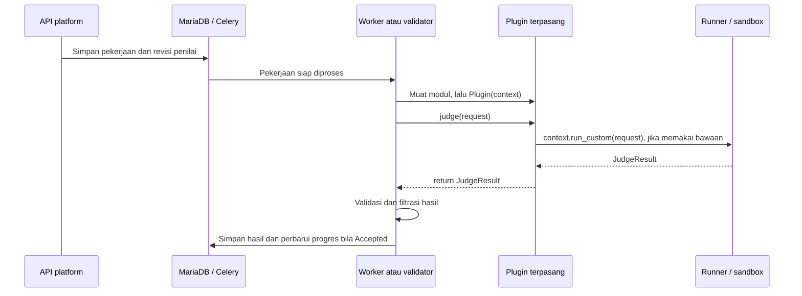

# Membuat plugin penilaian KodeLab dari nol

Panduan ini menjelaskan **kontrak plugin API v1 yang sudah diimplementasikan**, dari membuat folder sampai plugin dipakai pada soal. Contoh pertama menghasilkan penilai yang benar-benar menggunakan sandbox C/C++ bawaan. Anda tidak perlu mengedit registry core atau membuat subclass provider internal.

Mulai dari [membuat folder](#2-buat-folder-plugin-sendiri), [metadata](#3-tulis-metadata-pluginjson), dan [kode minimal](#4-tulis-pluginpy-paling-sederhana). Referensi pengembangan tersedia pada [SDK](#6-fungsi-dan-tipe-yang-disediakan-sdk), [callback](#9-callback-dan-hook-apa-yang-tersedia), [pengujian](#12-uji-kode-sebelum-dipaketkan), dan [instalasi](#13-buat-zip-dan-pasang).

## 1. Kenali pembagian core dan plugin

```text
app/
  judge_plugins.py              Installer, aktivasi, versi, dan uninstall
  plugin_sdk.py                 Antarmuka yang boleh dipakai pengembang plugin
  contracts.py                  Struktur request dan hasil
  providers.py                  Adapter pemuatan plugin oleh worker
  judging.py                    Validasi hasil, filtrasi test privat, nilai biner
  tasks.py                      Antrean, retry, penyimpanan hasil dan progres
plugin/
  custom/provider.py            Penilai sandbox bawaan
  examples/sandbox-delegate/    Contoh source plugin installable
  examples/sandbox-delegate.zip Contoh ZIP siap dipasang
  installed/<sha256>.py         Salinan lokal source ketika worker memakainya
```

Core menangani autentikasi, hak akses, antrean, database, progres, dan leaderboard. Plugin menerima pekerjaan penilaian dan mengembalikan hasil. **Plugin tidak perlu menyimpan nilai, mengubah progres, atau memanggil endpoint submission lagi.**

Plugin adalah kode server tepercaya dengan hak proses worker, termasuk akses database, jaringan internal, dan test privat. Kode siswa harus tetap dieksekusi melalui sandbox atau backend penilai yang memiliki isolasi setara; jangan menjalankan source/binary siswa langsung memakai `exec`, `eval`, atau `subprocess` di worker.

## 2. Buat folder plugin sendiri

Dari direktori utama proyek, buat folder baru:

```powershell
New-Item -ItemType Directory -Path plugin/penilai_saya
```

Buat dua file berikut melalui editor, simpan sebagai UTF-8:

```text
plugin/penilai_saya/
  plugin.json
  plugin.py
```

Folder ini adalah **source pengembangan**, bukan direktori yang otomatis dideteksi sebagai instalasi. Plugin harus dipaketkan dan dipasang melalui halaman admin. Jangan menyunting `plugin/installed/` untuk mengubah plugin terpasang.

## 3. Tulis metadata plugin.json

Isi lengkap `plugin/penilai_saya/plugin.json`:

```json
{
  "api_version": 1,
  "id": "penilai-saya",
  "name": "Penilai Saya",
  "version": "1.0.0",
  "description": "Penilai C/C++ menggunakan sandbox bawaan KodeLab",
  "capabilities": {
    "languages": ["c17", "cpp17"],
    "custom_input": true
  }
}
```

| Field | Arti dan batas |
|---|---|
| `api_version` | Harus `1`; versi kontrak platform, bukan versi plugin |
| `id` | Identitas tetap: diawali huruf kecil, berisi huruf kecil/angka/`-`, maksimum 30 karakter |
| `name` | Nama tampilan, 1–80 karakter |
| `version` | Versi paket, maksimum 40 karakter; misalnya `1.0.0` atau `1.1.0-beta.1` |
| `description` | Deskripsi opsional, maksimum 1.000 karakter |
| `capabilities.languages` | `c17`, `cpp17`, atau keduanya; tidak boleh duplikat |
| `capabilities.custom_input` | `true` jika plugin mendukung mode **Jalankan** dengan input sendiri; default `true` |

ID `custom` dan `domjudge` dicadangkan. Field metadata tambahan yang belum dikenal akan ditolak. `partial_scoring`, `implemented`, dan `test_details` bukan field manifest API v1; core menentukan kemampuan tersebut. Belum ada konfigurasi khusus per plugin/per soal yang otomatis diteruskan ke plugin.

## 4. Tulis plugin.py paling sederhana

Isi lengkap `plugin/penilai_saya/plugin.py`:

```python
from app.plugin_sdk import JudgeRequest, JudgeResult


class Plugin:
    def __init__(self, context):
        self.context = context

    def judge(self, request: JudgeRequest) -> JudgeResult:
        return self.context.run_custom(request)
```

Cara membacanya:

1. **Anda mengimplementasikan `Plugin`** dengan nama persis ini pada tingkat modul. Untuk paket API v1, tulis metode `judge` langsung di kelas tersebut; installer memeriksa keberadaannya.
2. **Core membuat instance** dengan `Plugin(context)`. Simpan `context` agar dapat dipakai di `judge()`.
3. **Core memanggil `judge(request)`** ketika worker menerima pekerjaan. Metode ini harus sinkron, bukan `async def`.
4. **Plugin memanggil fungsi bawaan** lewat `self.context.run_custom(request)`. Ini mengompilasi C/C++, menjalankan test case di runner/sandbox, dan menghasilkan `JudgeResult`.
5. **Plugin mengembalikan hasil ke core** dengan `return`. Core memvalidasi, menyaring test privat, lalu menyimpan hasil dan memperbarui progres jika sesuai.

Plugin ini tidak menambahkan aturan looping dan tidak membandingkan teks kode dengan kunci. Ia memakai mekanisme penilaian bawaan dengan test case dan checker `tokens-v1`.

## 5. Bagaimana core memanggil plugin?



Saat upload, core hanya memeriksa metadata dan sintaks. **Upload maupun aktivasi tidak mengeksekusi modul atau memanggil constructor.** Saat dipakai, worker memuat source dari database, membuat salinan lokal, mengeksekusi kode tingkat modul, membuat `Plugin(context)`, kemudian memanggil `judge(request)`.

Modul dan instance dibuat kembali untuk setiap pemanggilan. Validasi solusi acuan memanggil plugin sekali untuk setiap bahasa yang diizinkan. Retry juga dapat memanggilnya kembali dengan ID attempt yang sama. Jangan mengandalkan variabel global atau `self` untuk menyimpan status permanen; hindari efek samping yang akan terduplikasi saat retry. Jika backend eksternal mendukung idempotensi, gunakan `str(request.attempt_id)` sebagai kuncinya.

Metode internal `capabilities()`, `health_check()`, `prepare_problem()`, `submit()`, dan `get_result()` milik adapter core **bukan hook plugin installable**. Anda tidak harus mengimplementasikannya; menambahkan metode dengan nama tersebut ke kelas `Plugin` tidak membuat core otomatis memanggilnya.

## 6. Fungsi dan tipe yang disediakan SDK

Gunakan impor dari `app.plugin_sdk` sebagai titik integrasi. Impor langsung dari `app.tasks`, `app.learning`, `app.providers`, atau model database akan membuat plugin bergantung pada detail internal.

| Nama | Jenis | Cara memakai |
|---|---|---|
| `JudgeRequest` | Model input | Diterima sebagai parameter `judge(request)` |
| `JudgeResult` | Model hasil | Dikembalikan oleh `judge()` |
| `Case` | Model test case | Tersedia pada `request.cases` |
| `CaseResult` | Model hasil per kasus | Dipakai saat membangun hasil sendiri |
| `PluginContext` | Objek bantuan | Diberikan core ke constructor, tidak perlu dibuat sendiri saat produksi |
| `context.run_custom(request)` | Fungsi SDK bawaan | Menjalankan request melalui penilai sandbox bawaan, mengembalikan `JudgeResult` |
| `ProviderUnavailable` | Exception | Dapat dilempar jika layanan penilaian tidak tersedia |

`context.run_custom()` saat ini merupakan satu-satunya metode bantuan pada context. Tidak ada `context.save_score()`, `context.complete_step()`, `context.emit()`, atau `context.get_config()`.

Fungsi core berikut tetap dipanggil platform; ini membantu membaca alur kode, **bukan API yang harus dipanggil dari plugin**:

| Fungsi core | Pemanggil dan tanggung jawab |
|---|---|
| `provider_for(...)` di `app/providers.py` | Worker memilih adapter dan revisi paket yang sesuai pekerjaan |
| `InstalledProvider.submit(...)` | Adapter memuat source, membuat `Plugin(context)`, dan memanggil `judge()` |
| `public_result(...)` di `app/judging.py` | Worker memvalidasi konsistensi hasil, menyaring test privat, dan menghitung nilai |
| `record_accepted_completion(...)` di `app/learning.py` | Worker mencatat langkah selesai setelah hasil penilaian Accepted memenuhi syarat |

Jangan memanggil `provider_for()` untuk mencari plugin yang sedang berjalan atau mengirim ulang pekerjaan dari `judge()`: itu bukan cara menggunakan runner bawaan. Panggil `context.run_custom(request)` tepat di tempat Anda membutuhkan eksekusinya.

## 7. Data apa yang diterima judge()?

`request` adalah objek Pydantic, sehingga dibaca dengan atribut seperti `request.source`, bukan `request["source"]`.

| Atribut | Isi |
|---|---|
| `attempt_id` | UUID identitas eksekusi; serialisasikan dengan `str(...)` |
| `language` | `c17` atau `cpp17` |
| `source` | Kode sumber siswa atau solusi acuan; maksimum 32.768 karakter pada model request internal |
| `mode` | `judge` untuk penilaian, `run` untuk input percobaan |
| `checker` | Saat ini hanya `tokens-v1` |
| `limits.compile_seconds` | Waktu kompilasi; default 10 detik, rentang 1–15 |
| `limits.time_seconds` | Waktu per test; default 2 detik, rentang 1–5 |
| `limits.memory_mb` | Default 128 MiB, rentang 64–256 |
| `limits.output_bytes` | Default 65.536 byte, rentang 1.024–65.536 |
| `cases` | Daftar 1–10 objek `Case` |

Setiap `Case` memiliki `id`, `input`, `expected`, dan `public`. Dalam mode `judge`, gunakan test case dan jawaban acuan yang diterima; jangan mengganti ID-nya. Dalam mode `run`, terdapat satu kasus input percobaan dan `expected` biasanya `None`; hasil suksesnya adalah `EXECUTED`.

API kiriman publik juga membatasi source sampai 32.768 **byte UTF-8** dan menolak NUL. Plugin tidak boleh menganggap semua karakter berukuran satu byte. Data test case privat boleh dipakai untuk menilai, tetapi tidak boleh disalin ke log, pesan umum, atau layanan eksternal yang tidak dipercaya.

Request API v1 tidak membawa ID kelas, identitas peserta, ID versi soal, konfigurasi aturan tambahan, atau callback URL. Jangan menambahkan field sendiri ke JSON request dengan menganggap core akan memahaminya. Untuk mengirim request yang ada ke backend kompatibel, gunakan `request.model_dump(mode="json")`; ini juga mengubah UUID menjadi string.

## 8. Bagaimana mengembalikan hasil sendiri?

Jika sudah memakai `context.run_custom()`, cukup kembalikan objek hasilnya. Jika memakai mesin lain, petakan respons mesin tersebut ke `JudgeResult` dan `CaseResult`.

Contoh bentuk hasil berikut **hanya ilustrasi struktur untuk request dengan dua test case**, bukan implementasi mesin penilaian:

```python
from app.plugin_sdk import CaseResult, JudgeResult


def contoh_bentuk_hasil(request):
    return JudgeResult(
        verdict="WRONG_ANSWER",
        compile_log="",
        environment="mesin-saya-v1",
        cases=[
            CaseResult(
                id=request.cases[0].id,
                verdict="ACCEPTED",
                stdout="5\n",
                time_ms=12,
            ),
            CaseResult(
                id=request.cases[1].id,
                verdict="WRONG_ANSWER",
                stdout="0\n",
                time_ms=10,
            ),
        ],
    )
```

Aturan hasil yang wajib diikuti:

- Jika kompilasi gagal, kembalikan `COMPILATION_ERROR`, isi `compile_log` yang aman ditampilkan, dan `cases=[]`.
- Selain kegagalan kompilasi, laporkan semua ID kasus tepat sekali. Pertahankan urutan kasus request agar verdict pertama yang gagal sesuai urutan pengujian.
- Mode `judge` menerima verdict kasus: `ACCEPTED`, `WRONG_ANSWER`, `RUNTIME_ERROR`, `TIME_LIMIT_EXCEEDED`, `MEMORY_LIMIT_EXCEEDED`, atau `OUTPUT_LIMIT_EXCEEDED`.
- Verdict agregat mode `judge` adalah kegagalan pertama dalam urutan hasil; jika semua kasus Accepted, agregatnya `ACCEPTED`.
- Mode `run` menggunakan `EXECUTED` untuk sukses, atau verdict kegagalan eksekusi yang sesuai. Jangan memberikan `ACCEPTED` untuk run biasa.
- `stdout` dan `stderr` berupa string; `time_ms` berupa integer atau `None`.
- `JudgeResult` tidak memiliki field `score`, `passed_tests`, `progress`, atau status custom. Core menurunkan nilai 100 dari agregat Accepted, selain itu 0 untuk penilaian yang selesai; mode run tidak diberi nilai. Nilai parsial belum tersedia.
- Core menambahkan identitas plugin, versi, dan SHA revisi ke `environment` hasil.

Core menyaring `input`, `expected`, `stdout`, `stderr`, dan waktu kasus tersembunyi dari hasil siswa. `compile_log` dan `environment` tidak disaring per kasus: jangan menaruh test privat, token, URL internal sensitif, atau source acuan di sana.

## 9. Callback dan hook: apa yang tersedia?

API v1 memiliki pemanggilan constructor dan satu entry point pekerjaan: `judge(request)`. **Belum ada hook otomatis** `on_install`, `on_activate`, `on_deactivate`, `on_uninstall`, `before_judge`, `after_judge`, callback progres, webhook hasil, atau metode `poll/get_result` pada kelas plugin.

Anda dapat membuat fungsi sebelum/sesudah penilaian sendiri, tetapi harus memanggilnya secara eksplisit. Contoh lengkap alternatif untuk `plugin.py`:

```python
import logging
from app.plugin_sdk import JudgeRequest, JudgeResult

logger = logging.getLogger(__name__)


class Plugin:
    def __init__(self, context):
        self.context = context

    def before_judge(self, request: JudgeRequest):
        logger.info("Plugin mulai attempt=%s", request.attempt_id)

    def after_judge(self, request: JudgeRequest, result: JudgeResult):
        logger.info("Plugin selesai attempt=%s verdict=%s", request.attempt_id, result.verdict)
        return result

    def judge(self, request: JudgeRequest) -> JudgeResult:
        self.before_judge(request)  # Dipanggil oleh kode kita, bukan otomatis oleh core.
        result = self.context.run_custom(request)
        return self.after_judge(request, result)
```

Kedua fungsi itu bukan callback yang didaftarkan ke framework. Kalau pemanggilannya dihapus dari `judge()`, keduanya tidak berjalan. Hasil `return` merupakan cara menyampaikan penyelesaian kepada core; jangan memanggil API progres secara terpisah.

Untuk aturan seperti wajib looping, Anda perlu menulis pemeriksaan struktur kode sendiri atau memakai parser yang sesuai. SDK belum menyediakan helper AST/looping. Jangan sekadar mengganti verdict agregat tanpa menyesuaikan hasil kasus; core akan menolaknya jika tidak konsisten.

## 10. Memakai backend penilai eksternal

Ini alternatif lengkap untuk `plugin.py` jika Anda mempunyai endpoint **kompatibel `JudgeRequest`/`JudgeResult`** di `POST /judge`. Contoh ini bukan integrasi DOMjudge; DOMjudge memerlukan pemetaan protokol tersendiri.

```python
import os
import httpx
from app.plugin_sdk import JudgeRequest, JudgeResult, ProviderUnavailable


class Plugin:
    def __init__(self, context):
        self.context = context

    def judge(self, request: JudgeRequest) -> JudgeResult:
        base_url = os.environ.get("MY_JUDGE_URL")
        if not base_url:
            raise ProviderUnavailable("my_judge_not_configured")
        try:
            response = httpx.post(
                base_url.rstrip("/") + "/judge",
                json=request.model_dump(mode="json"),
                headers={"Idempotency-Key": str(request.attempt_id)},
                timeout=30,
            )
            response.raise_for_status()
            return JudgeResult.model_validate(response.json())
        except (httpx.HTTPError, ValueError) as exc:
            raise ProviderUnavailable("my_judge_unavailable") from exc
```

Pengelola server harus menambahkan `MY_JUDGE_URL` pada environment **worker dan validator** lalu memperbarui container terkait. Menambahkan variabel ke `.env` saja tidak otomatis meneruskannya ke container; deklarasikan juga di Compose. Jangan menaruh kredensial di metadata paket. Jaringan worker saat ini internal, sehingga akses layanan eksternal juga harus disiapkan oleh pengelola.

Backend eksternal bertanggung jawab menerapkan sandbox, batas waktu/memori/output, serta pemetaan verdict dan ID kasus. HTTPX sudah terpasang. Paket ZIP tidak memasang dependensi Python atau software sistem tambahan. Jika backend asinkron, plugin harus melakukan submit/poll sendiri sampai memperoleh hasil lengkap dengan batas waktu yang jelas; core belum menyediakan callback/webhook untuk menyelesaikannya nanti.

## 11. Error, retry, dan batas waktu

| Keadaan | Tindakan plugin |
|---|---|
| Jawaban siswa salah | Kembalikan `WRONG_ANSWER` dengan hasil kasus lengkap |
| Source siswa gagal kompilasi | Kembalikan `COMPILATION_ERROR`, log aman, kasus kosong |
| Program siswa melewati batas waktu | Kembalikan `TIME_LIMIT_EXCEEDED` pada kasus yang sesuai |
| Layanan penilai mati, timeout HTTP, hasil tak dapat dipercaya | Lempar `ProviderUnavailable` atau exception; jangan mengarang nilai 0 |
| Hasil tidak sesuai kontrak | Core menolak hasil dan memperlakukannya sebagai gangguan pekerjaan |

Core menangani exception sebagai `retry_pending`, maksimal dua retry setelah percobaan awal, kemudian `system_error`. Gangguan infrastruktur tidak otomatis diberi nilai nol. Usahakan kode plugin dapat dijalankan ulang dengan aman; jangan menangkap semua exception lalu mengubahnya menjadi Wrong Answer.

Task kiriman memiliki soft/hard limit 165/175 detik; task validasi solusi acuan 330/345 detik. Validasi dapat mencakup kedua bahasa dalam satu task. Jangan melakukan polling tanpa batas, tidur panjang, atau meninggalkan pekerjaan penilaian yang berjalan di thread setelah `judge()` sudah mengembalikan hasil.

## 12. Uji kode sebelum dipaketkan

Untuk contoh minimal pada langkah 4, Anda bisa menguji pemanggilan SDK tanpa Docker runner menggunakan context tiruan. Simpan kode berikut sebagai `plugin/penilai_saya/check_plugin.py` **hanya untuk pengembangan**, jangan masukkan ke ZIP:

```python
import importlib.util
from pathlib import Path
from unittest.mock import Mock
from uuid import uuid4
from app.plugin_sdk import Case, CaseResult, JudgeRequest, JudgeResult

spec = importlib.util.spec_from_file_location("plugin_under_test", Path(__file__).with_name("plugin.py"))
module = importlib.util.module_from_spec(spec)
spec.loader.exec_module(module)
request = JudgeRequest(
    attempt_id=uuid4(), language="c17", source="int main(void){return 0;}",
    mode="judge", limits={}, cases=[Case(id="sample", input="", expected="")],
)
expected = JudgeResult(
    verdict="ACCEPTED", cases=[CaseResult(id="sample", verdict="ACCEPTED")],
)
context = Mock()
context.run_custom.return_value = expected
result = module.Plugin(context).judge(request)
context.run_custom.assert_called_once_with(request)
assert result == expected
print("PASS plugin memanggil runner bawaan dan mengembalikan hasil")
```

Dari root proyek, gunakan Python 3 dengan dependensi aplikasi terpasang:

```powershell
python -m plugin.penilai_saya.check_plugin
```

Untuk menjalankan di image aplikasi tanpa memasang Python/dependensi di host, gunakan Compose dan mount source lokal:

```powershell
docker compose run --rm --no-deps -v "${PWD}:/workspace" -w /workspace api python -m plugin.penilai_saya.check_plugin
```

Tes ini membuktikan alur pemanggilan contoh minimal, bukan kebenaran compiler, keamanan plugin, atau kebenaran backend eksternal. Setelah instalasi, tetap lakukan **Uji kunci** dengan compiler C17/C++17 yang sebenarnya.

## 13. Buat ZIP dan pasang

Dari root proyek, gunakan **Python 3**; pastikan `python --version` menunjukkan Python 3 (image aplikasi memakai Python 3.12). Jika alias host menunjuk versi lain, pakai interpreter Python 3 yang sesuai atau perintah Docker berikut.

```powershell
python scripts/package-plugin.py plugin/penilai_saya penilai-saya-1.0.0.zip
```

Alternatif tanpa Python di host:

```powershell
docker compose run --rm --no-deps -v "${PWD}:/workspace" -w /workspace api python scripts/package-plugin.py plugin/penilai_saya penilai-saya-1.0.0.zip
```

Skrip memasukkan hanya `plugin.json`, `plugin.py`, dan `README.md` jika ada. Ia menolak menimpa output yang sudah ada. Format akhir harus seperti ini:

```text
penilai-saya-1.0.0.zip
  plugin.json
  plugin.py
  README.md       # opsional
```

Jangan ZIP folder pembungkus `penilai-saya/`. Folder bertingkat, file tambahan, symlink, duplikasi nama, serta ZIP terenkripsi ditolak. Ukuran ZIP **dan** total isi maksimum 256 KiB. API v1 menerima satu modul Python; letakkan helper dalam `plugin.py`, bukan menambahkan file `.py` lain ke ZIP. Standard library dan dependensi image dapat diimpor; `requirements.txt` dalam ZIP tidak didukung.

Pasang dan gunakan:

1. Login admin, buka **Plugin penilaian** pada sidebar atau `#/admin/plugins`.
2. Pilih ZIP, konfirmasi kepercayaan kode, klik **Pasang plugin**, lalu **Aktifkan**.
3. Login pengajar/admin, buka **Bank soal**, buat soal baru atau revisi soal terbit.
4. Pilih **Penilai Saya** pada kolom **Plugin penilaian**, simpan draft.
5. Klik **Uji kunci**. Periksa hasil setiap bahasa, lalu terbitkan jika lolos.
6. Untuk pemakaian siswa, pastikan versi soal itu dipakai dalam learning path yang diterbitkan. Path/enrollment lama tetap mengikuti referensi versinya; menerbitkan revisi soal tidak mengganti semua referensi lama otomatis.

Soal terbit memiliki dropdown yang dikunci. Gunakan **Ganti plugin melalui revisi** atau **Buat revisi baru**. Aktivasi tidak mengganti penilai seluruh soal. Jika tab sudah terbuka sebelum pembaruan aplikasi, muat ulang penuh dengan Ctrl+F5.

## 14. Di mana source terpasang disimpan?

| Lokasi | Fungsi |
|---|---|
| `plugin/penilai_saya/` di host | Source yang Anda kembangkan sendiri |
| Tabel `judge_plugins` | Identitas, status aktif, revisi yang dipilih |
| Tabel `judge_plugin_versions` | Metadata dan source setiap versi; penyimpanan utama yang ikut backup database |
| `/app/plugin/installed/<sha256>.py` di container | Salinan yang dibuat ketika container itu mengeksekusi plugin |

Upload/aktivasi tidak langsung membuat file di worker. **Uji kunci** membuat salinan di container `validator`; kiriman atau run membuatnya di `worker`. Container tidak berbagi cache dan folder tersebut tidak di-bind mount ke host. File cache dapat hilang saat container dibuat ulang; source utama tetap di database dan akan dimuat lagi saat digunakan.

Untuk memeriksa cache setelah pekerjaan berjalan:

```powershell
docker compose exec validator ls -la /app/plugin/installed
docker compose exec worker ls -la /app/plugin/installed
```

## 15. Memperbarui, menonaktifkan, dan menghapus

- Pertahankan ID plugin, naikkan `version`, ubah source, paketkan ulang, lalu upload. Nomor versi terpasang tidak dapat ditimpa.
- Versi baru tidak otomatis aktif. Admin memilih versi dan menekan **Terapkan versi**.
- Validasi solusi acuan mengunci revisi plugin pada versi soal dan job validasi; attempt juga menyimpan revisinya. Soal terbit tidak berganti mesin hanya karena versi plugin aktif berubah. Buat revisi soal dan validasi ulang untuk menggunakan versi baru.
- Menonaktifkan plugin menolak pekerjaan baru, tetapi pekerjaan yang sudah diterima tetap menyelesaikan revisi yang dikunci. Histori tetap dapat ditinjau.
- Uninstall hanya dapat dilakukan jika plugin nonaktif dan tidak dirujuk kelas, versi soal, attempt, atau job validasi. Versi lama dipertahankan untuk reproduksibilitas. Cache lokal bukan registry dan tidak menjadi sumber utama instalasi.
- Nonaktif bukan penghentian darurat kode berbahaya. Jika plugin berbahaya, hentikan worker dan tangani kredensial/data terdampak; SDK tidak mengisolasi plugin dari proses server.

## 16. Pemecahan masalah

| Gejala | Yang perlu diperiksa |
|---|---|
| ZIP ditolak | Kedua file berada di akar ZIP, metadata API v1, kelas `Plugin` dengan `def judge`, sintaks valid, ukuran, dan nomor versi baru |
| Terpasang/aktif, tetapi tidak dipakai | Pilih plugin pada draft soal, simpan, uji kunci, terbitkan, dan gunakan versi soal yang benar pada path |
| Pilihan hanya menampilkan penilai lama | Jika soal terbit, buat revisi; periksa plugin aktif dan muat ulang tab |
| Folder installed kosong | Plugin belum dieksekusi di container tersebut, atau container baru dibuat ulang |
| `system_error` | Periksa exception/koneksi backend, format hasil, dependensi, dan batas waktu di log worker/validator |
| Tidak bisa uninstall | Plugin masih aktif atau dirujuk soal/histori |

```powershell
docker compose logs --tail 100 worker validator
```

Log core mencatat kategori error dan ID pekerjaan tanpa source atau payload. Untuk diagnostik tambahan pada plugin sendiri, log ID/status yang aman; jangan log request lengkap, source peserta, test privat, password, atau token.

## 17. Referensi API dan batas saat ini

- `GET /admin/judge-plugins`: daftar versi/status, khusus admin.
- `POST /admin/judge-plugins`: JSON `{ "package_base64": "...", "trusted_code": true }`.
- `PATCH /admin/judge-plugins/{id}`: `{ "enabled": true, "revision": "sha256..." }`; revisi opsional untuk perubahan status saja.
- `DELETE /admin/judge-plugins/{id}`: uninstall plugin nonaktif yang tidak dirujuk.
- `GET /providers`: builtin dan plugin aktif beserta kemampuan/revisi, tanpa source. `healthy` plugin installable berarti paket aktif tersedia, bukan pengujian koneksi backend eksternalnya.

Operasi perubahan memerlukan admin, autentikasi, serta CSRF/origin yang valid jika menggunakan cookie, dan dicatat dalam audit. Installer memeriksa format/sintaks, **bukan membuktikan keamanan source**. Instalasi tidak menjalankan pip/shell dan tidak mengunduh paket dari URL. Hanya runner yang memegang Docker socket.

API v1 belum menyediakan marketplace, paket multi-modul, pengaturan plugin per soal, callback lifecycle, nilai parsial, verdict pedagogis baru, atau helper AST. Integrasi DOMjudge tetap ditunda. Contoh yang sudah tersedia ada di [sandbox-delegate/plugin.py](examples/sandbox-delegate/plugin.py) dan [metadata contoh](examples/sandbox-delegate/plugin.json).

Sumber kontrak untuk dicocokkan saat pengembangan: [SDK](../app/plugin_sdk.py), [model input/hasil](../app/contracts.py), [adapter pemanggil](../app/providers.py), dan [validasi hasil core](../app/judging.py).
